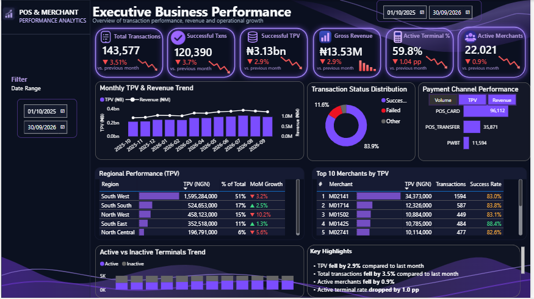

# pos-merchant-performance-analysis
SQL and Power BI analysis of simulated POS transactions, merchants and terminals

> The data is simulated. No real merchant, customer or company data is used.

## Business questions
- How much payment value (TPV) and revenue is the business generating?
- How reliable are transactions, and where do they fail?
- Which payment channels, regions and merchants drive performance?
- How well are POS terminals being used?

## Tech stack
PostgreSQL, SQL, Power BI

## Data
11 relational tables and 150,000 simulated payment transactions. The dashboard
covers October 2025 to September 2026 (143,577 transactions).

## Key findings
- 83.9% of transactions succeed and 11.6% fail
- ₦3.13bn successful payment value (TPV) and ₦13.53M gross revenue
- POS card produces about 67% of TPV and 77% of revenue, with an effective fee
  of roughly 0.50% against 0.30% for transfers and PWBT
- The South West generates 51% of TPV; the North West fell 10.2% month on month
- 59.8% of terminals were active across the period, improving through the year
- In the latest month, TPV was down 2.9% and transactions down 3.5%
  compared with the previous month

  ## Recommendations
1. **Reactivate idle terminals.** About one in three terminals was still inactive
   in the latest month. They are deployed but earning nothing.
2. **Investigate transaction failures.** With 11.6% of transactions failing,
   break failures down by channel, region and terminal to find the cause.
3. **Address regional concentration.** The South West produces 51% of TPV, and
   the South West and North West drove most of the latest month's dip. Look into
   what is happening in the North West.
4. **Learn from the best-performing merchant.** M01425 has the highest success
   rate among the top merchants (88.4% against a 83.9% average). Study what it
   does differently.

## Repository contents
- `01_schema.sql`: database tables
- `data_validation.sql`: data quality checks
- `eda_pos_merchant_analytics.sql`: analysis queries and the views used by the dashboard

## Links
Portfolio: [add link] | Dashboard walkthrough: [add video link]
